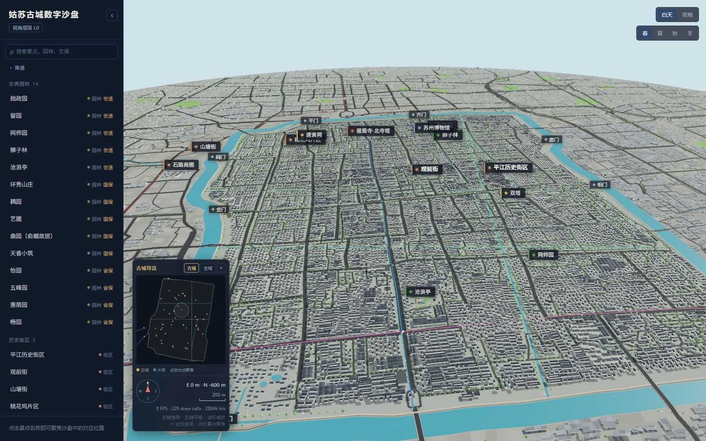
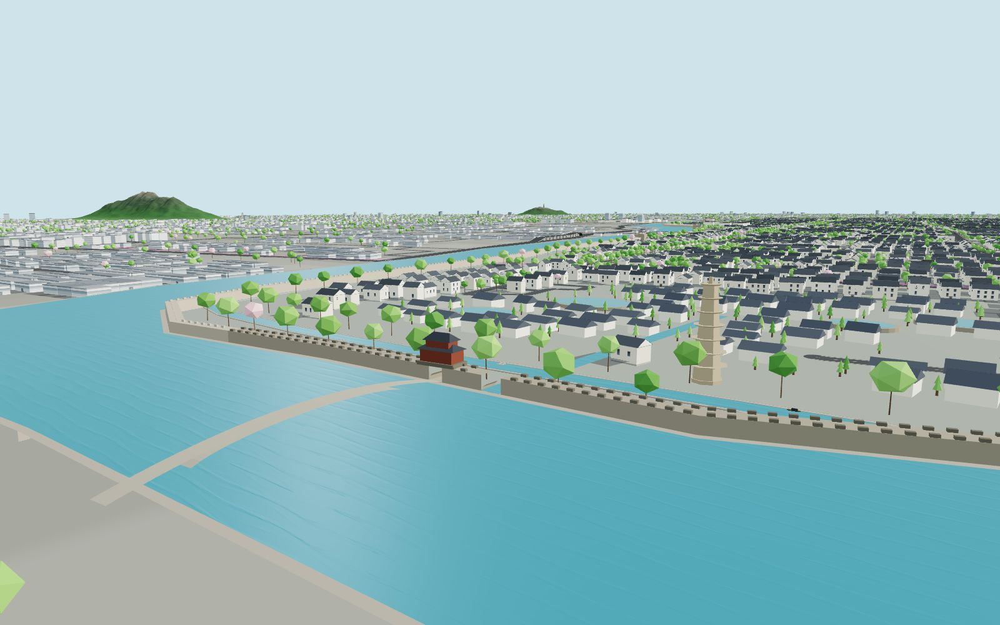
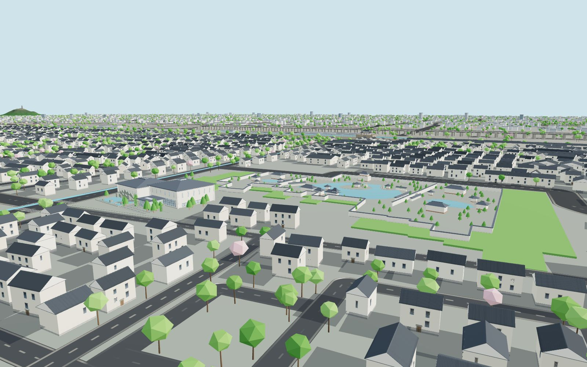
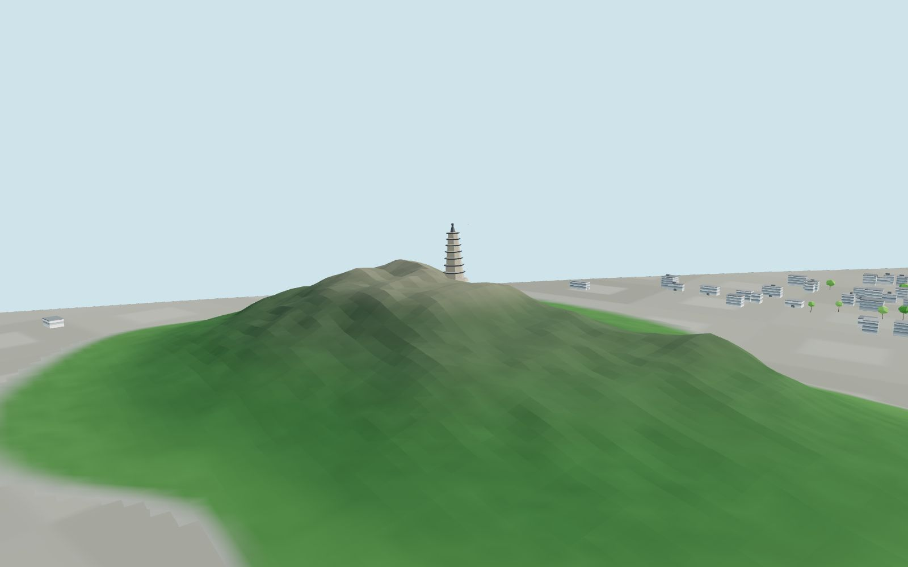
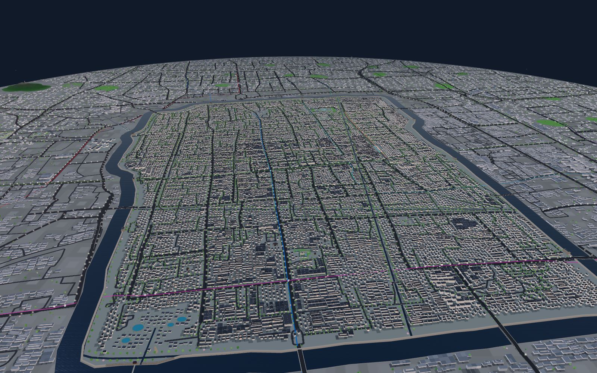
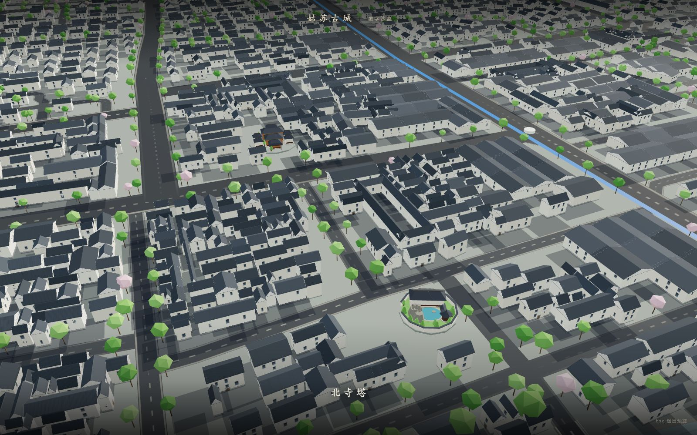

# 姑苏古城数字沙盘


把 14.2 km² 的苏州古城装进浏览器：2.5 万栋建筑、1300 km 街巷、护城河与城内水网、城墙城门、50 处景点（含 31 处国保/省保），可自由漫游、按四季昼夜切换、一键播放 60 秒全屏电影预览并导出 MP4。

基于 OpenStreetMap 数据程序化重建，React 18 + Three.js + TypeScript。



---

## 沙盘里有什么

### 古城肌理

- **2.5 万栋建筑**：城内白墙黛瓦、坡屋顶、院落式布局；城外按现代街区生成，肌理与高度都有区分。
- **1300 km 路网**：主干道、支路、步行街分级渲染，车道线、斑马线在路面着色器里绘制，远近都清晰。
- **城内水网**：平江河、干将河等河道与驳岸、临水民居、跨河石拱桥一体化建模；城外上塘河、山塘河从留园与虎丘山脚绕行。
- **城墙与城门**：整圈城墙沿真实轮廓连续生成，含垛口、马道与八座城门；盘门水陆城门、瑞光塔、吴门桥按真实形制重建。
- **盘门景区**：城门后方腹地填满 69 处院落、4 片水池与 139 棵点景树，避让水道与塔基，与四周街巷自然衔接。
- **地铁网络**：线路走向与站点位置来自 OSM，按地下浅埋处理，不打断地面路网。

### 50 处景点，31 处文保

景点不是统一占位方块，而是按类型程序化生成的建筑群，共 7 种原型：

| 类型 | 内容 |
| --- | --- |
| 园林 | 园墙、水池、厅堂、攒尖亭、游廊、太湖石假山、点景树 |
| 寺观 | 牌坊、山门、重檐大殿、配殿、戏台、泮池 |
| 宅第 | 多进院落、备弄、门厅与楼厅 |
| 塔 | 楼阁式砖塔，逐层收分与叠涩檐口 |
| 城门 | 城台、门洞、重檐城楼 |
| 碑刻 | 太湖石峰、碑亭 |
| 近代建筑 | 红砖校舍、钟楼 |

每处朝向与布景由 id 派生的确定性种子决定，同类不雷同；全部按材质合并，四季换色。拙政园、虎丘、北寺塔、双塔、平江路等核心景点另有手工 GLB 精模。

### 四季与昼夜

- 春樱、夏荫、秋叶、冬雪四套植被与地表配色，草坪、树冠、落叶同步切换。
- 白天与夜晚两套光照：夜间窗光、路灯、天空反射与整体色调一并切换。

---

## 功能

### 自由漫游

左键旋转、右键平移、滚轮缩放，围着沙盘任意看。侧栏可收起，3D 地名标签与小地图跟着视角联动。

### 景点聚焦

侧栏列表、3D 标签、小地图光点任一处点击，相机平滑飞向该景点；点空白处回到全景。

### 搜索与筛选

侧栏支持名称与描述搜索，可按类型、优先级、文保等级（国保/省保）、世遗多维筛选，列表、标签、小地图三处同步。

### 小地图

左下角 2D 导览，显示城墙轮廓、水系、景点与当前视点，支持「古城 / 全域」两档视图。

### 全屏电影预览

`P` 开始 60 秒一镜到底的古城巡礼，`Esc` 退出。预览时侧栏、HUD、小地图与 3D 标签全部隐藏，画面满屏，只留片名与段落题字；播完自动还原机位与昼夜。

路线：**盘门 · 水门 → 北寺塔 → 拙政园 → 狮子林 → 双塔 → 天幕俯瞰全城**。段间共享端点、Catmull-Rom 弧长采样，全程无硬切。

### 一键导出 MP4

点视口底部「导出 MP4」或按 `R`，自动进入预览并实时录制：WebGL 画面与片名、题字合成到 1920×1080 画布，H.264 编码，预览结束或按 `Esc` 后自动下载 `姑苏古城.mp4`。浏览器不支持 MP4 录制时退回 WebM 并提示。

### 快捷键

| 按键 | 作用 |
| --- | --- |
| `P` | 全屏预览（60 秒） |
| `R` | 预览并导出 MP4 |
| `Esc` | 退出预览 |
| `H` | 收放侧栏 |

---

## 截图

| 盘门 · 水门 | 拙政园 |
| --- | --- |
|  |  |

| 虎丘斜塔 | 古城夜景 |
| --- | --- |
|  |  |



---

## 快速开始

```bash
# 环境：Node.js ≥ 20.11，推荐 Node 22
npm ci                # 安装依赖
npm run dev           # 开发服务器 http://localhost:5173
npm run build         # 类型检查 + 生产构建（输出 dist/）
npm run preview       # 预览生产构建 http://localhost:4173
```

开发环境可用 URL 参数直接落到指定状态：`?time=night&season=winter`、`?cam=x,y,z&target=x,y,z`、`?hide=roads,banks`、`?mark=1`。

> Windows 若装有 DLP 加密软件（如 E-SafeNet），`node_modules` 中的 `.d.ts` 可能被加密，导致 `tsc` 报 `TS1490 File appears to be binary`。这与源码无关，用 `npx vite build` 跳过类型检查即可构建。

---

## 技术实现

- **渲染**：React Three Fiber + drei；建筑、桥、树按材质合并为少量 draw call，全景约 170 draw calls / 212k tris。
- **LOD 三级**：近景补灯杆、灯头等细节，中景起显示斑马线，远景只留体块与屋顶。
- **数据管线**：建筑 / 路网 / 水系 / 城墙城门 / 桥 / 树 / 地铁七类数据，由 `scripts/rebuild-all.mjs` 统一编排。

```bash
npm run data:all      # 抓取 OSM → 加工 → 数据门禁
npm run data:fetch    # 只抓取原始数据
npm run data:build    # 只加工（需 data/raw 就绪）
npm run data:qa       # 只跑数据门禁
```

- **质量控制**：`npm test`（Vitest 67 个纯函数用例）、`npm run typecheck`、`npm run data:qa`（数据门禁），以及针对路网、桥、城墙、模型压路等场景的浏览器探针脚本。

目录结构的简要说明：

```
src/components/   场景与 UI（Scene / Sidebar / HUD / MiniMap / Heritage / Panmen 等）
src/data/         景点、文保、建模规格与场景几何
src/utils/        纯函数（坐标、几何、水域、剖线裁剪）
scripts/          OSM 抓取、数据加工、质量门禁
public/data/      前端消费的建筑 / 路网 / 地铁数据
public/models/    核心景点 GLB 精模
docs/             需求、技术方案、数据管线手册
```

---

## 数据来源与许可

- 建筑、道路、水系、城墙、桥、地铁等基础数据来自 [OpenStreetMap](https://www.openstreetmap.org/)，遵循 ODbL 许可，使用时请保留署名。
- 景点信息与文保等级整理自公开资料，精模由 Blender 手工制作。
- 项目代码以 [MIT](./LICENSE) 许可发布。
